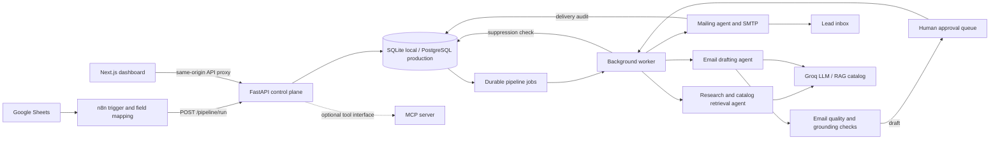

# Lead Generation & Outreach Orchestrator

A portfolio project for turning Google Sheets lead submissions into researched, reviewed, personalized email drafts. The system combines n8n ingestion, a FastAPI control plane, a durable worker, specialized AI agents, PostgreSQL/SQLite persistence, SMTP delivery, and a Next.js review dashboard.

New leads are deduplicated by email and queued for background processing. By default, generated email drafts wait for human approval. Delivery can stay in dry-run mode until SMTP has been configured and the operator deliberately enables live delivery.

## Architecture

The supplied diagram shows the original integration concept. The Mermaid diagram below reflects the current implementation and separates the API, worker, database, and dashboard roles.




### Processing lifecycle

1. n8n maps a Google Sheets row to the API lead schema and posts it to `/pipeline/run`.
2. FastAPI validates required fields, rejects previously seen or suppressed email addresses, stores the lead, and creates a durable job.
3. The worker researches the lead, retrieves relevant catalog products, drafts two email variants, and runs quality checks.
4. Drafts are saved as plain text and responsive HTML. With the default `REQUIRE_EMAIL_APPROVAL=true`, the lead waits in `PENDING_APPROVAL`.
5. An operator compares Variations A and B, selects one, and either approves it or enters revision notes. Rewrites run as durable jobs and are quality-checked before the updated draft returns to review.
6. After approval, the worker rechecks suppression and prior delivery state, then records the selected variation's SMTP attempt and result.

## What is implemented

- **Agent Workflow:** Specialized agents for research, product catalog retrieval, email drafting, quality & grounding review, and SMTP delivery.
- **RAG Catalog Grounding:** Multi-product catalog retrieval (16 products across Voice AI, Analytics, and Automation) using semantic sentence-transformer embeddings with keyword fallback. Supports domain-wide product mapping (e.g. `Voice Models` expands to all voice offerings) and Unicode hyphen normalization.
- **Durable Job Queue:** SQLite/PostgreSQL durable job storage with atomic job claiming (`FOR UPDATE SKIP LOCKED` on PostgreSQL). Jobs survive server restarts and network interruptions.
- **Strict Email Deduplication:** Submissions are deduplicated by case-insensitive email address and idempotency keys to prevent duplicate leads or spamming recipients.
- **Human Review & AI Rewrites:** Compare Variation A and Variation B with responsive HTML email previews. Operators can approve or provide revision notes for targeted LLM rewrites.
- **Targeted Multi-Select & Bulk Operations:** Select specific leads via dashboard checkboxes to send or schedule outreach exclusively to them, or use 1-click **Send All Pending**.
- **Outreach Scheduling:** Flexible delivery scheduling (+1h, +3h, tomorrow at 9:00 AM, or custom datetime) with delayed queue claiming via `scheduled_for`.
- **Auto-Send Toggle:** Quickly switch between manual review mode and auto-dispatch mode.
- **One-Click Lead Retry:** Instantly re-queue failed leads for processing via `POST /leads/{id}/retry` or directly from the dashboard.
- **Reply-Aware Follow-Up Engine:**
  - Automated 2-step follow-up sequences (step 1 check-in, step 2 breakup email).
  - RFC 2822 email threading with `In-Reply-To`, `References`, and `Re:` subject lines.
  - Pre-send atomic suppression verification (re-checks reply, bounce, unsubscribe, and suppression status right before delivery).
- **Inbound Event & Mailbox Ingestion:**
  - `POST /webhooks/inbound-email` for incoming mailbox replies.
  - `POST /webhooks/events` for ESP delivery, bounce, and unsubscribe notifications.
  - `InboundClassifier` deterministic rules to categorize replies, bounces, unsubscribes, and out-of-office (OOO) notes.
  - OOO auto-delays follow-up jobs by 5 business days; replies immediately cancel pending sequences; bounces/unsubscribes automatically add the address to the suppression table.
- **Database Backup & Recovery CLI:** `backend/backup.py` supports zero-downtime SQLite backups and compressed PostgreSQL dumps with automated retention pruning.
- **API Security & Same-Origin Proxy:** Bearer token authentication in production; the Next.js API proxy handles tokens securely without exposing them to browser JavaScript.
- **Full Next.js Operations Dashboard:** Real-time metrics, status filters, lead inspector, HTML preview iframes, and bulk action toolbar.

## Quick start: local development

Requirements: Python 3.10+, Node.js 18+, and npm.

```bash
python3 -m venv .venv
source .venv/bin/activate
pip install -r requirements.txt
npm install
cp .env.example .env
```

Set `GROQ_API_KEY` in `.env` to enable AI enrichment and drafting. Optional semantic retrieval dependencies are installed with `pip install -r requirements-ml.txt`; without them the catalog uses keyword search. For safe local work, keep:

```dotenv
DRY_RUN_MODE=true
REQUIRE_EMAIL_APPROVAL=true
```

Start the API (it starts the local worker thread by default):

```bash
source .venv/bin/activate
python backend/api.py
```

In another terminal, start the dashboard:

```bash
npm run dev
```

Open <http://localhost:3000>. The API is at <http://localhost:8000>; API docs are at <http://localhost:8000/docs> in development. To receive rows from a remote n8n server, expose port 8000 through a secure tunnel and configure the workflow’s URL. Configure bearer authentication in both the API and n8n before exposing a non-demo instance.

For an isolated synthetic dashboard dataset, run `python backend/seed_demo_data.py`; it creates `data/demo_leads.db` with `example.com` addresses. To serve it separately, start another API with `DATABASE_PATH=./data/demo_leads.db API_PORT=8001 python backend/api.py`.

## Docker Compose deployment

Copy `.env.example` to `.env`, then set unique values for `POSTGRES_PASSWORD`, `POSTGRES_URL`, `API_AUTH_TOKEN`, and `ADMIN_API_TOKEN`. Set your Groq and SMTP credentials as needed. The `POSTGRES_URL` hostname must be `db` for Compose networking. For non-ASCII or reserved password characters, URL-encode the password in the connection URL.

```bash
docker compose up --build
```

Compose applies the Alembic migration before starting the API and worker. The dashboard is available on port 3000 and the API on port 8000. The API requires a bearer token in production; configure the n8n HTTP Request node to send `Authorization: Bearer <API_AUTH_TOKEN>`. The dashboard proxy supplies API credentials from the server environment and does not send them to browser JavaScript.

Before live delivery, configure a valid Gmail app password or another SMTP provider. Keep `DRY_RUN_MODE=true` while reviewing drafts and verifying configuration. `DRY_RUN_MODE=false` allows approved drafts to reach SMTP. Do not place secrets in the workflow JSON or commit `.env`.

## API overview

Operational endpoints require `Authorization: Bearer <API_AUTH_TOKEN>` when a token is configured; production requires one.

| Method | Endpoint | Purpose |
| --- | --- | --- |
| `GET` | `/health` | Database-backed health check |
| `GET` | `/metrics` | Lead, delivery, queue, and inbound event metrics |
| `GET` | `/leads` | Paginated lead list; supports status filter |
| `GET` | `/leads/{id}` | Lead and latest enrichment details |
| `GET` | `/leads/{id}/messages` | Saved email variants and preview content |
| `POST` | `/pipeline/run` | Validate, deduplicate, and queue a lead |
| `GET` | `/jobs/{job_id}` | Durable job status and progress |
| `POST` | `/leads/{id}/approve` | Queue delivery of reviewed draft (supports `scheduled_for`) |
| `POST` | `/leads/bulk-approve` | Bulk approve & send/schedule outreach for specifically selected leads |
| `POST` | `/leads/approve-all` | Approve and send/schedule all leads awaiting review |
| `POST` | `/leads/{id}/retry` | Re-queue a failed lead for processing with updated catalog checks |
| `POST` | `/leads/{id}/revise` | Queue an LLM rewrite using `{"variation":"A","feedback":"..."}` |
| `POST` | `/leads/{id}/followup` | Manually schedule a follow-up email step for a lead |
| `POST` | `/leads/{id}/cancel-followup` | Cancel any pending follow-up jobs for a lead |
| `POST` | `/webhooks/inbound-email` | Ingest incoming email replies for classification and thread updating |
| `POST` | `/webhooks/events` | Ingest ESP delivery, bounce, and unsubscribe webhook events |
| `GET` | `/inbound-events` | List recorded inbound events and classification intent |
| `POST` | `/suppression` | Add an address to the do-not-contact list (admin token) |

The Google Sheets workflow should map fields such as `name`, `email`, `company`, `job_title`, `company_website`, `industry`, `interest_area`, `challenge`, `company_size`, `linkedin_url`, and `comments` into `lead_data`. Empty required values are rejected with HTTP 422; duplicate email submissions return a duplicate result rather than an error.

## Configuration reference

See [.env.example](.env.example) for all supported variables. The main controls are:

| Variable | Default | Description |
| --- | --- | --- |
| `GROQ_API_KEY` | empty | Enables AI research/drafting |
| `GROQ_MODEL` | `openai/gpt-oss-120b` | Groq chat model |
| `DRY_RUN_MODE` | `true` | Prevents SMTP delivery |
| `REQUIRE_EMAIL_APPROVAL` | `true` | Holds drafts until dashboard approval |
| `SMTP_HOST`, `SMTP_PORT`, `SMTP_USERNAME`, `SMTP_PASSWORD` | Gmail defaults/empty credentials | SMTP transport settings |
| `SMTP_FROM_EMAIL`, `SENDER_NAME`, `REPLY_TO_EMAIL` | sender defaults | Message identity and reply address |
| `DATABASE_URL` | empty | Optional SQLAlchemy database URL; SQLite is used otherwise |
| `API_AUTH_TOKEN` | empty in development | API bearer token; mandatory in production |
| `ADMIN_API_TOKEN` | empty in development | Protects destructive/admin operations |

## Tests and quality checks

```bash
.venv/bin/python -m unittest discover -s tests -v
npx tsc --noEmit
npm run build
```

The GitHub Actions workflow runs Python unit tests, TypeScript checks, and a Next.js production build. Docker services can be checked with `docker compose config` before startup.

## Reply-aware follow-up engine and operations

- **Inbound Event & Reply Ingestion:** `POST /webhooks/inbound-email` and `POST /webhooks/events` handle incoming mailbox replies and ESP delivery/bounce events.
- **Classification & State Machine:** Inbound events are classified into `REPLY`, `BOUNCE`, `UNSUBSCRIBE`, or `OOO`. A human reply marks the lead as `REPLIED` and immediately cancels all queued follow-ups. Bounces and unsubscribes transition the lead and automatically write to the `suppression` table.
- **Scheduled Pre-Send Verification:** Follow-up jobs run on a durable schedule (`scheduled_for`). The worker verifies that the lead has not replied, bounced, unsubscribed, or been suppressed at the exact moment of dispatch.
- **Thread Continuity:** Follow-up messages set `In-Reply-To` and `References` headers referencing the previous message ID and format subjects as `Re: <Original Subject>`.
- **Database Backup & Recovery:** `backend/backup.py` supports atomic SQLite snapshots and gzip-compressed PostgreSQL dumps with retention pruning.

Production deployment also needs operational choices for secret management, backups/restore, SMTP provider quotas, monitoring/alerting, privacy retention, and verified unsubscribe/compliance handling. The Compose file is a reproducible single-host baseline, not a managed high-availability deployment.

## Future improvements & recommended roadmap

Here are high-impact enhancements to take this orchestrator to enterprise grade:

1. **Bi-Directional CRM Sync (HubSpot / Salesforce / Pipedrive / Close)**:
   - Synchronize lead status, conversation notes, email records, and reply events directly into your CRM.
   - Automatically create deals or update pipeline stages when a lead replies with interest.
2. **Autonomous IMAP / Gmail API Mailbox Polling**:
   - In addition to webhooks, add a standing background polling worker (IMAP IDLE or Gmail Pub/Sub) so self-hosted email accounts without webhook capabilities can detect replies automatically.
3. **Smart Sending Warmup & Cadence Throttle**:
   - Add mailbox warmup modes with daily sending caps (e.g., ramping from 20 to 100 emails/day).
   - Randomize send intervals (e.g. 45–180 seconds between consecutive emails) and align sends with the recipient’s local business hours timezone.
4. **Engagement Tracking (Pixel & Click-Wrap Analytics)**:
   - Track 1x1 transparent open-tracking pixels and signed redirect URLs.
   - Compare real open and click-through rates (CTR) between Variation A and Variation B directly on the dashboard.
5. **Multi-Channel Fallback (LinkedIn InMail & SMS)**:
   - If an email remains unread after step 1, automatically trigger a personalized LinkedIn connection request or InMail via the LinkedIn MCP tool / API.
6. **AI Reply Copilot & Objection Handling**:
   - When a prospect replies, an agent analyzes the response (e.g. pricing objection, request for demo, wrong person), searches the knowledge base, and drafts a proposed response for one-click operator approval.

## Resume-ready project summary

> Built a multi-agent lead research and email outreach platform with n8n ingestion, a FastAPI control plane, durable PostgreSQL job processing, idempotent lead intake, human-approved personalized email, SMTP audit trails, and a Next.js operations dashboard. Added API authentication, schema migrations, Docker Compose deployment, and CI checks.

## Repository map

- `backend/agents/` — research, email drafting, quality checks, and delivery agents
- `backend/api.py` — FastAPI routes and local worker lifecycle
- `backend/database.py` — database schema and persistence operations
- `backend/worker.py` — durable job consumer
- `backend/migrations/` — Alembic schema history
- `pages/` — Next.js dashboard and server-side API proxy
- `n8n/` — workflow export and setup notes
- `mcp_server/` — optional MCP tool server
- `docs/architecture-overview.png` — supplied architecture diagram
