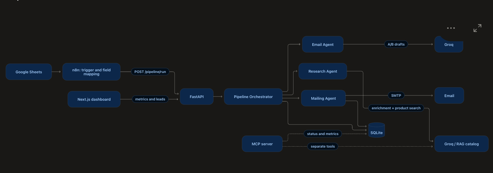
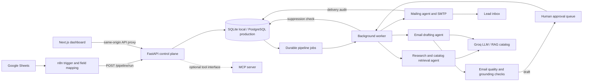

# Lead Generation & Outreach Orchestrator

A portfolio project for turning Google Sheets lead submissions into researched, reviewed, personalized email drafts. The system combines n8n ingestion, a FastAPI control plane, a durable worker, specialized AI agents, PostgreSQL/SQLite persistence, SMTP delivery, and a Next.js review dashboard.

New leads are deduplicated by email and queued for background processing. By default, generated email drafts wait for human approval. Delivery can stay in dry-run mode until SMTP has been configured and the operator deliberately enables live delivery.

## Architecture

The supplied diagram shows the original integration concept. The Mermaid diagram below reflects the current implementation and separates the API, worker, database, and dashboard roles.





### Processing lifecycle

1. n8n maps a Google Sheets row to the API lead schema and posts it to `/pipeline/run`.
2. FastAPI validates required fields, rejects previously seen or suppressed email addresses, stores the lead, and creates a durable job.
3. The worker researches the lead, retrieves relevant catalog products, drafts two email variants, and runs quality checks.
4. Drafts are saved as plain text and responsive HTML. With the default `REQUIRE_EMAIL_APPROVAL=true`, the lead waits in `PENDING_APPROVAL`.
5. An operator compares Variations A and B, selects one, and either approves it or enters revision notes. Rewrites run as durable jobs and are quality-checked before the updated draft returns to review.
6. After approval, the worker rechecks suppression and prior delivery state, then records the selected variation's SMTP attempt and result.

## What is implemented

- **Agent workflow:** separate research, email drafting, quality review, and mailing agents.
- **Durable jobs:** jobs and progress survive API restarts; the worker claims jobs from the database.
- **Idempotency:** duplicate sheet triggers for an email do not create a second lead or job.
- **Review before send:** approval is enabled by default; the dashboard shows a rendered email preview.
- **Safer delivery:** multipart plain-text and HTML messages, sender/reply-to configuration, SMTP timeouts, and delivery audit records.
- **Suppression groundwork:** suppressed addresses are checked before processing and again before sending. An authenticated API endpoint can add an address to the suppression list.
- **API boundary:** optional bearer-token authentication in development and required API credentials in production; dashboard credentials are kept server-side by the Next.js proxy.
- **Storage and migrations:** SQLite for local development, PostgreSQL for Compose deployment, and Alembic migrations.
- **Observability:** health, metrics, job status, and per-lead message endpoints.
- **Reproducibility:** Docker Compose services for PostgreSQL, migration, API, worker, and dashboard, plus CI checks.

## Quick start: local development

Requirements: Python 3.10+, Node.js 18+, and npm.

```bash
python3 -m venv .venv
source .venv/bin/activate
pip install -r requirements.txt
npm install
cp .env.example .env
```

Set `GROQ_API_KEY` in `.env` to enable AI enrichment and drafting. Optional semantic retrieval dependencies are installed with `pip install -r requirements-ml.txt`; without them the catalog uses keyword search. For safe local work, keep:

```dotenv
DRY_RUN_MODE=true
REQUIRE_EMAIL_APPROVAL=true
```

Start the API (it starts the local worker thread by default):

```bash
source .venv/bin/activate
python backend/api.py
```

In another terminal, start the dashboard:

```bash
npm run dev
```

Open <http://localhost:3000>. The API is at <http://localhost:8000>; API docs are at <http://localhost:8000/docs> in development. To receive rows from a remote n8n server, expose port 8000 through a secure tunnel and configure the workflow’s URL. Configure bearer authentication in both the API and n8n before exposing a non-demo instance.

For an isolated synthetic dashboard dataset, run `python backend/seed_demo_data.py`; it creates `data/demo_leads.db` with `example.com` addresses. To serve it separately, start another API with `DATABASE_PATH=./data/demo_leads.db API_PORT=8001 python backend/api.py`.

## Docker Compose deployment

Copy `.env.example` to `.env`, then set unique values for `POSTGRES_PASSWORD`, `POSTGRES_URL`, `API_AUTH_TOKEN`, and `ADMIN_API_TOKEN`. Set your Groq and SMTP credentials as needed. The `POSTGRES_URL` hostname must be `db` for Compose networking. For non-ASCII or reserved password characters, URL-encode the password in the connection URL.

```bash
docker compose up --build
```

Compose applies the Alembic migration before starting the API and worker. The dashboard is available on port 3000 and the API on port 8000. The API requires a bearer token in production; configure the n8n HTTP Request node to send `Authorization: Bearer <API_AUTH_TOKEN>`. The dashboard proxy supplies API credentials from the server environment and does not send them to browser JavaScript.

Before live delivery, configure a valid Gmail app password or another SMTP provider. Keep `DRY_RUN_MODE=true` while reviewing drafts and verifying configuration. `DRY_RUN_MODE=false` allows approved drafts to reach SMTP. Do not place secrets in the workflow JSON or commit `.env`.

## API overview

Operational endpoints require `Authorization: Bearer <API_AUTH_TOKEN>` when a token is configured; production requires one.

| Method | Endpoint | Purpose |
| --- | --- | --- |
| `GET` | `/health` | Database-backed health check |
| `GET` | `/metrics` | Lead, delivery, and queue metrics |
| `GET` | `/leads` | Paginated lead list; supports status filter |
| `GET` | `/leads/{id}` | Lead and latest enrichment details |
| `GET` | `/leads/{id}/messages` | Saved email variants and preview content |
| `POST` | `/pipeline/run` | Validate, deduplicate, and queue a lead |
| `GET` | `/jobs/{job_id}` | Durable job status and progress |
| `POST` | `/leads/{id}/approve` | Queue delivery of the reviewed draft; body accepts `{"variation":"A"}` or `{"variation":"B"}` |
| `POST` | `/leads/{id}/revise` | Queue an LLM rewrite using `{"variation":"A","feedback":"..."}` |
| `POST` | `/suppression` | Add an address to the do-not-contact list (admin token) |

The Google Sheets workflow should map fields such as `name`, `email`, `company`, `job_title`, `company_website`, `industry`, `interest_area`, `challenge`, `company_size`, `linkedin_url`, and `comments` into `lead_data`. Empty required values are rejected with HTTP 422; duplicate email submissions return a duplicate result rather than an error.

## Configuration reference

See [.env.example](.env.example) for all supported variables. The main controls are:

| Variable | Default | Description |
| --- | --- | --- |
| `GROQ_API_KEY` | empty | Enables AI research/drafting |
| `GROQ_MODEL` | `openai/gpt-oss-120b` | Groq chat model |
| `DRY_RUN_MODE` | `true` | Prevents SMTP delivery |
| `REQUIRE_EMAIL_APPROVAL` | `true` | Holds drafts until dashboard approval |
| `SMTP_HOST`, `SMTP_PORT`, `SMTP_USERNAME`, `SMTP_PASSWORD` | Gmail defaults/empty credentials | SMTP transport settings |
| `SMTP_FROM_EMAIL`, `SENDER_NAME`, `REPLY_TO_EMAIL` | sender defaults | Message identity and reply address |
| `DATABASE_URL` | empty | Optional SQLAlchemy database URL; SQLite is used otherwise |
| `API_AUTH_TOKEN` | empty in development | API bearer token; mandatory in production |
| `ADMIN_API_TOKEN` | empty in development | Protects destructive/admin operations |

## Tests and quality checks

```bash
.venv/bin/python -m unittest discover -s tests -v
npx tsc --noEmit
npm run build
```

The GitHub Actions workflow runs Python unit tests, TypeScript checks, and a Next.js production build. Docker services can be checked with `docker compose config` before startup.

## Current boundaries and next milestone

This milestone does **not** ingest inbound replies, detect out-of-office messages or bounces, or schedule follow-up emails. The suppression table and pre-send checks provide groundwork for those controls, but they do not determine whether a recipient has replied. The follow-up milestone should add inbound mailbox/webhook ingestion, normalized reply and bounce events, an explicit outreach state machine, and a scheduled job that rechecks reply, bounce, unsubscribe, and suppression state immediately before each follow-up.

Production deployment also needs operational choices for secret management, backups/restore, SMTP provider quotas, monitoring/alerting, privacy retention, and verified unsubscribe/compliance handling. The Compose file is a reproducible single-host baseline, not a managed high-availability deployment.

## Resume-ready project summary

> Built a multi-agent lead research and email outreach platform with n8n ingestion, a FastAPI control plane, durable PostgreSQL job processing, idempotent lead intake, human-approved personalized email, SMTP audit trails, and a Next.js operations dashboard. Added API authentication, schema migrations, Docker Compose deployment, and CI checks.

## Repository map

- `backend/agents/` — research, email drafting, quality checks, and delivery agents
- `backend/api.py` — FastAPI routes and local worker lifecycle
- `backend/database.py` — database schema and persistence operations
- `backend/worker.py` — durable job consumer
- `backend/migrations/` — Alembic schema history
- `pages/` — Next.js dashboard and server-side API proxy
- `n8n/` — workflow export and setup notes
- `mcp_server/` — optional MCP tool server
- `docs/architecture-overview.png` — supplied architecture diagram
